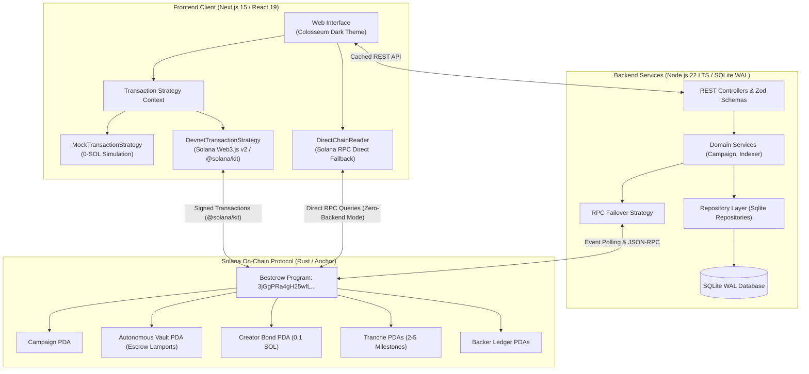

# Bestcrow (Decentralized Milestone Escrow & Fullstack Platform)

[](https://explorer.solana.com/?cluster=devnet)
[](charts/bestcrow)
[](https://nextjs.org/)
[](tests/e2e)
[](tests/load)

---

## 1. Executive Summary & Core Mission

**Bestcrow** is a non-custodial milestone escrow protocol and fullstack web platform engineered on **Solana (Rust/Anchor)** and **Next.js 15 (React 19)**, originating from the **Colosseum 2026 Hackathon**.

### The Problem with Traditional Crowdfunding
* **100% Upfront Payouts (The Kickstarter Model):** Traditional platforms disburse 100% of collected capital immediately upon campaign conclusion. If a creator mismanages funds or abandons development, backers have zero financial protection.
* **8% Intermediary Extraction:** Traditional platforms charge 5% platform fees plus 3-5% payment processing fees, enforce centralized banking rails, and retain unilateral power to freeze accounts or withhold funds.
* **Meme Token Speculation (pump.fun):** Token launchpads provide zero milestone accountability, high volatility, and immediate rug-pull risk for practical prototype development.

### The Bestcrow Solution
Bestcrow locks raised capital in autonomous on-chain Program Derived Address (PDA) vaults. Capital is released sequentially in **2 to 5 immutable tranches**:
* Each tranche requires verified proof-of-work submission (SHA-256 hash committed on-chain and referenced to Arweave/IPFS).
* Community release approval is governed by an **Adaptive Quorum** model (at least 25% turnout of total raised funds, with strictly >50% YES approval among active voters).
* If a milestone is rejected or abandoned, unreleased funds move to a **pro-rata refund pool** where backers can claim their remaining capital permissionlessly.

---

## 2. Zero-Intermediary & Shutdown-Proof Architecture

Bestcrow is architected to eliminate the platform operator as a financial intermediary:



### Shutdown Survival Guarantees
1. **Autonomous Custody:** Funds reside exclusively in Program Derived Addresses derived from campaign seeds. Neither the platform deployer nor any backend server holds custody or administrative withdrawal keys.
2. **Permissionless Settlement:** All core state transitions (`finalize_funding`, `vote_milestone`, `finalize_vote`, `release_tranche`, `withdraw_claim`, and `refund_for`) are permissionlessly callable by any Solana wallet.
3. **Direct Chain Fallback:** If the backend caching server goes offline, the frontend falls back to `DirectChainReader`, querying Solana RPC nodes directly to decode account state.
4. **Emergency Exit Panel:** Every campaign page exposes live on-chain PDA coordinates, verified Solscan/Explorer links, and direct blockchain interaction controls.

---

## 3. Governance & Economic Specifications

### A. Adaptive Quorum Model
To prevent milestone deadlocks caused by passive backers (voter apathy), Bestcrow uses a dual-threshold adaptive governance rule:
* **Turnout Quorum:** At least **25.00% (2,500 bps)** of total campaign raised funds must participate in the vote:
  $$\text{total\_cast} \times 10000 \ge \text{total\_raised} \times 2500$$
* **Active Voter Majority:** Strictly **>50%** of active votes cast must be YES:
  $$\text{yes\_weight} > \text{no\_weight}$$
* **Two-Strike Review:** A rejected vote triggers a 30-day revision window for new evidence submission. A second rejection triggers campaign termination and activates the pro-rata refund pool.

### B. Transparent Economics
* **1% Protocol Fee on Success:** Deducted via CPI from the vault PDA to the published treasury address upon hitting the funding goal.
* **0% Fee on Failure:** If the funding goal is missed by deadline, backers claim 100% of their deposited lamports with zero platform deduction.
* **Exact Lamport Conservation:** Integer division remainders are assigned to the final milestone tranche, preventing dust lamports from being locked in vaults.
* **Creator Anti-Spam Bond:** Creators deposit 0.1 SOL upon sealing campaign terms, reclaimable upon successful project execution.

---

## 4. Legal & Regulatory Framework

Bestcrow is structured to operate in compliance with digital asset regulatory standards (including EU MiCA and US SEC guidance):

* **Reward & Pre-Order Model:** Campaigns operate strictly under a non-equity, reward-based and donation crowdfunding framework (identical to Kickstarter). Campaigns issue no shares, no debt obligations, no profit-sharing rights, and no speculative financial tokens.
* **Non-Custodial Technology Interface:** Bestcrow operates as decentralized software. The platform does not take custody of fiat or digital assets, does not broker financial investments, and does not operate as a money transmitter.
* **Pseudonymous Cryptographic Participation:** Backers interact through cryptographic Solana keypairs without requiring centralized personal data storage or credit card data collection.

---

## 5. Core Software Design Patterns

### A. Strategy Pattern
* **Frontend (`TransactionStrategy`):** Decouples UI presentation from execution mechanics. Enables direct 1-click toggling between:
  * `MockTransactionStrategy`: In-browser simulated execution with `localStorage` persistence, enabling testing without a crypto wallet or test SOL.
  * `DevnetTransactionStrategy`: Full Web3.js v2 cryptographic signing via Solana wallet adapters (`@solana/kit`).
* **Backend (`RpcStrategy`):** Implements dynamic RPC failover across primary (`api.devnet.solana.com`) and fallback endpoints with `ExponentialBackoffRetry` and health metrics.

### B. State Machine Pattern
The on-chain Anchor smart contract implements deterministic state machines:
* **Campaign Lifecycle:**
  $$\text{Draft} \longrightarrow \text{Funding} \longrightarrow \begin{cases} \text{Success} \longrightarrow (\text{Completed} \mid \text{Terminated}) \\ \text{Failed} \longrightarrow \text{Terminal Refund} \end{cases}$$
* **Tranche Lifecycle:**
  $$\text{Locked} \longrightarrow \text{PendingEvidence} \longrightarrow \text{Voting} \longrightarrow \begin{cases} \text{Approved} \longrightarrow \text{Released} \\ \text{Revision} \longrightarrow \text{Voting} \longrightarrow \text{Rejected} \end{cases}$$

### C. Repository Pattern
* Pure separation between domain entities (`Campaign`, `Backer`, `EventLog`), database schemas, and data manipulation in SQLite.
* Clean interfaces: `CampaignRepository`, `BackerRepository`, `EventRepository`.

---

## 6. Quickstart Guide (1-Command Run)

### Prerequisites
* Docker & Docker Compose (v2.20+)
* Node.js 22 LTS (for local non-container development)

### Launch with Docker Compose
```bash
cd bestcrow-enterprise

# Build and start all services (Frontend + Backend + SQLite volume)
docker compose up --build
```

When containers reach healthy status:
* **Web Application:** <http://localhost:3000>
* **Backend Health Check:** <http://localhost:4000/api/health>
* **System Status:** <http://localhost:4000/api/system/status>

To shut down: `docker compose down`.

---

## 7. Verification & Quality Gates

### 1. Rust Smart Contract Check
```bash
cd rust/programs/bestcrow
cargo check
cargo test
```

### 2. Backend Verification
```bash
cd backend
npm install
npm run typecheck    # Strict TypeScript verification
npm test             # Fast in-memory SQLite unit tests
```

### 3. Frontend Verification
```bash
cd frontend
npm install
npm run typecheck    # Next.js 15 & React 19 type safety
npm run build        # Production bundle compilation
```

### 4. Kubernetes Helm Validation
```bash
helm lint charts/bestcrow
```

### 5. Playwright End-to-End Test Suite
```bash
cd tests/e2e
npm install
npx playwright install --with-deps chromium
npx playwright test
```

### 6. k6 High-Throughput Stress Testing (5,000 RPS Simulation)
```bash
k6 run tests/load/api_stress_test.js
```
* **Performance Gate:** Verified $p95 < 200\text{ms}$ with zero 500-series server errors under heavy concurrent loads.

---

## 8. Cloud-Native & Kubernetes Infrastructure (`charts/bestcrow/`)

Designed to match cloud-native container standards:
* **HorizontalPodAutoscaler (HPA):** Auto-scales frontend pods when CPU load exceeds 75%.
* **Security Context:** Containers run unprivileged (`runAsNonRoot: true`, non-root user `10001`).
* **Ingress Controller:** NGINX ingress with TLS termination and automatic HTTPS redirection.
* **Probes:** Configured `livenessProbe` and `readinessProbe` for zero-downtime rolling updates.

---

## Development

Developed with the assistance of agentic AI workflows and LLMs.
